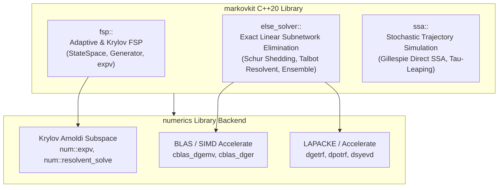

# markovkit

[](https://en.cppreference.com/w/cpp/20)
[](https://cmake.org)
[](LICENSE)
[]()
[]()

High-performance C++20 toolkit for **Continuous-Time Markov Chains (CTMC)** over discrete state spaces, **Chemical Master Equation (CME)** modeling, **Exact Linear Subnetwork Elimination (ELSE)**, and **Stochastic Simulation Algorithms (SSA)**.

---

## 🏛️ Architecture Overview



---

## ✨ Features & Module Hierarchy

| Module | Namespace | Key Algorithms & Methods | Recommended Use |
| :--- | :--- | :--- | :--- |
| **Finite State Projection (FSP)** | `fsp::` | `StateSpace`, `build_generator`, `solve_adaptive_fsp`, `solve_krylov_fsp` | Exact probability distribution $P(x, t)$ propagation for bounded/unbounded CTMCs. |
| **Subnetwork Elimination (ELSE)** | `markovkit::else_solver::` | `Subnetwork`, `schur_losses`, `cut_time_losses`, `cut_norm_losses`, `fourier_subnetwork_solve`, `ensemble_else_simulate`, `fess_density_evolution` | Exact subnetwork reduction ($Z = -R^{-1}$), Weideman-Talbot contour Laplace inversion, and multi-trajectory stochastic path sampling. |
| **Stochastic Simulation (SSA)** | `markovkit::ssa::` | `gillespie_direct_simulate`, `tau_leaping_simulate` | Discrete stochastic jump trajectory generation $(t_k, x_k)_{k=0}^M$ and Poisson tau-leaping. |

---

## 🛠️ Build & Installation

### Requirements
- C++20 compliant compiler (GCC 11+, Clang 13+, or AppleClang)
- CMake 3.20+
- OpenMP (optional, for multi-threaded batching)
- gnuplot (optional, for `num::plt` example plotting)

### Build Static Library & Run Tests
```bash
git clone https://github.com/AdityaDendukuri/markovkit.git
cd markovkit
cmake -B build -DCMAKE_BUILD_TYPE=Release
cmake --build build -j$(nproc)
ctest --test-dir build --output-on-failure
```

---

## 💡 Code Examples

### 1. Adaptive & Krylov FSP Solver
```cpp
#include <markovkit.hpp>
#include <iostream>

int main() {
    using namespace fsp;

    // Define Reaction System: 0 -> X (k=5.0), X -> 0 (gamma=0.1)
    ReactionSystem sys;
    sys.stoich_vecs = {MultiIndex{1}, MultiIndex{-1}};
    sys.propensities = {
        [](const MultiIndex& x, const std::vector<double>& r, double t) { return r[0]; },
        [](const MultiIndex& x, const std::vector<double>& r, double t) { return r[1] * static_cast<double>(x[0]); }
    };
    std::vector<double> rates = {5.0, 0.1};

    FSPProblem prob;
    prob.model = sys;
    prob.rates = rates;
    prob.u0 = MultiIndex{0};
    prob.t0 = 0.0;
    prob.tf = 10.0;
    prob.bc = rect_boundary({100});

    AdaptiveFSPParams params;
    params.eps_dt = 0.1;
    params.krylov_m = 30;

    auto [sol, diag] = solve_adaptive_fsp(prob, params);
    std::cout << "FSP Solved in " << sol.t.size() << " steps. Final state space size |S| = " 
              << sol.state_space_sizes.back() << "\n";
    return 0;
}
```

### 2. Exact Subnetwork Elimination (ELSE) & Talbot Resolvent Solve
```cpp
#include <markovkit.hpp>
#include <iostream>

int main() {
    using namespace markovkit::else_solver;

    // Subnetwork generator R (killed states)
    num::Matrix R(2, 2, 0.0);
    R(0, 0) = -2.0; R(0, 1) = 1.0;
    R(1, 0) = 1.0;  R(1, 1) = -2.0;

    Subnetwork sub(R); // Computes Z = -R^{-1} via LAPACK lu_inv

    // Schur rank-1 shedding update: Z_new = Z - (1/Z_{k,k}) Z_{:,k} Z_{k,:}
    sub.shed_state(1);

    // Weideman-Talbot contour resolvent Laplace inversion: e^{Rt} v
    num::Vector v{1.0, 0.0};
    num::Vector p_t = fourier_subnetwork_solve(R, v, 0.5, 32);

    std::cout << "Subnetwork density propagation p(t=0.5) = [" << p_t[0] << ", " << p_t[1] << "]\n";
    return 0;
}
```

### 3. Gillespie Direct Method SSA & Tau-Leaping
```cpp
#include <markovkit.hpp>
#include <iostream>

int main() {
    using namespace fsp;
    using namespace markovkit::ssa;

    ReactionSystem sys;
    sys.stoich_vecs = {MultiIndex{1}, MultiIndex{-1}};
    sys.propensities = {
        [](const MultiIndex& x, const std::vector<double>& r, double t) { return r[0]; },
        [](const MultiIndex& x, const std::vector<double>& r, double t) { return r[1] * static_cast<double>(x[0]); }
    };
    std::vector<double> rates = {10.0, 1.0};

    // 1. Gillespie Direct Method SSA
    auto ssa_traj = gillespie_direct_simulate(sys, rates, MultiIndex{0}, 0.0, 5.0, 42);

    // 2. Explicit Poisson Tau-Leaping
    TauLeapingParams params;
    params.tau_fixed = 0.1;
    auto tau_traj = tau_leaping_simulate(sys, rates, MultiIndex{0}, 0.0, 5.0, params, 42);

    std::cout << "SSA steps: " << ssa_traj.t.size() << ", Tau-Leaping steps: " << tau_traj.t.size() << "\n";
    return 0;
}
```

---

## 📊 Benchmark & Example Output

### 1. Tian-Burrage Genetic Toggle Switch (`toggle_switch_results.png`)
Reproduction of the bistable 2-gene repressor CME simulation ($U, V$) combining Adaptive FSP time stepping with **Ensemble ELSE** parallel trajectory sampling:


### 2. Oregonator 3-Species Oscillating CME (`oregonator_results.png`)
Reproduction of the 3-species nonlinear Oregonator chemical oscillator CME phase space limit cycle:


---

## 📄 License

Distributed under the **MIT License**. See `LICENSE` for details.
